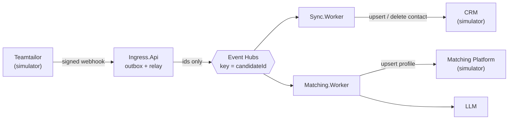
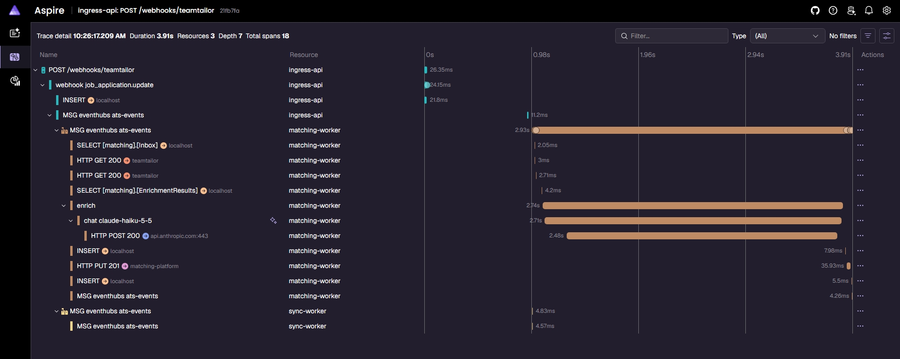

# TalentSync

[](https://github.com/wcislom/TalentSync/actions/workflows/ci.yml)

An event-driven integration that syncs candidate data from an ATS (Teamtailor) to a CRM and to a consultant
matching platform, with LLM enrichment of consultant profiles.

A portfolio project: a simplified model of a real-world integration. Not production code, but designed to behave
correctly under failure: duplicate deliveries, retries, crashes and downstream outages.

> **Status: MVP done**, except Teamtailor webhook signature v2 verification (scenarios I3–I4), which comes next.
> Until then Ingress accepts unsigned webhooks.

## How it works



- **Sync.Worker**: candidate created, updated or deleted → CRM contact upserted or marked as deleted.
- **Matching.Worker**: job application reaches the qualified stage → the LLM suggests skills and seniority →
  consultant profile upserted. If the LLM fails, the profile is created as `NotEnriched`.

Key decisions:

- **Notify-then-fetch**: events carry only IDs; workers fetch current state from the API.
- **Outbox** in Ingress; **at-least-once** delivery; **idempotent upserts** keyed by `candidateId`.
- **Parking lot** instead of a dead-letter queue, which Event Hubs doesn't have.
- **LLM results stored** by candidate, CV hash and prompt version before the profile upsert, so retries replay the
  same decision.

More: [architecture](docs/architecture.md), [diagrams](docs/diagrams.md), [domain](docs/domain.md),
[acceptance scenarios](docs/acceptance-scenarios.md).

Stack: .NET 10, Azure Event Hubs SDK (no messaging framework), SQL Server 2025 + EF Core,
`Microsoft.Extensions.Http.Resilience` (Polly v8), `Microsoft.Extensions.AI` with the Anthropic SDK (Claude),
OpenTelemetry + Aspire Dashboard, xUnit v3 + Testcontainers, Docker Compose, GitHub Actions.

## Observability

One webhook is one trace across the three hosts, through the outbox and Event Hubs
([ADR 010](docs/adr/010-observability.md)). Below: a job application reaches the qualified stage. Ingress stores
the webhook and the relay publishes it. Matching.Worker checks its inbox, fetches the application and the candidate,
finds no stored enrichment, calls Claude, stores the result, upserts the profile, writes the inbox and checkpoints.
Sync.Worker ignores `job_application.*` events, so its branch is only a checkpoint.



## Testing

- **Acceptance scenarios** ([docs/acceptance-scenarios.md](docs/acceptance-scenarios.md)) are the definition of done:
  Given/When/Then examples of the domain rules and invariants, written before the code. Each automated scenario has
  exactly one integration test named after its ID, e.g. `S4` (CRM outage delays but does not lose events) or `M3`
  (LLM timeout yields a `NotEnriched` profile). The tests run the three hosts and the simulators in process against
  SQL Server, Azurite and the Event Hubs emulator in Testcontainers, and break the simulators on purpose.
- **Unit tests** per project: the domain model, use cases, failure classification in the consumer skeleton, HTTP
  clients and their resilience, the Teamtailor anti-corruption layer.
- **CI** (GitHub Actions) builds and runs everything on every PR, with a test report and a coverage summary.
- **Prompt evaluation** ([ADR 009](docs/adr/009-prompt-evaluation.md)): the enrichment prompt is scored offline
  against a golden set of fictional CVs (`eval/cases/`, including a prompt injection and a Polish CV) for validity,
  recall, precision, hallucinations, seniority and stability. Run by hand, never in CI, because it calls the real
  model; reports are in [`eval/reports/`](eval/reports/). CI only checks that a report exists for the current prompt.

## Decisions

The reasoning is in [architecture decision records](docs/adr/README.md):

| ADR | Decision |
|---|---|
| [001](docs/adr/001-project-structure.md) | Project structure by context, then by layer; a project wherever the compiler should enforce a rule |
| [002](docs/adr/002-event-hubs-over-service-bus.md) | Event Hubs over Service Bus: replay and independent consumers, at the cost of a DLQ |
| [003](docs/adr/003-notify-then-fetch.md) | Notify-then-fetch: the event is a signal, the API state is the truth |
| [004](docs/adr/004-transactional-outbox.md) | Transactional outbox in Ingress, one relay |
| [005](docs/adr/005-idempotency.md) | Idempotent effects, per-worker inbox, checkpoint after processing, stored LLM results |
| [006](docs/adr/006-partition-key-candidate-id.md) | Partition key = `candidateId`: ordering per candidate |
| [007](docs/adr/007-llm-enrichment.md) | LLM enrichment: own port, PII masking, validation, timeout and fallback to `NotEnriched` |
| [008](docs/adr/008-source-of-truth-and-sync-direction.md) | One-way sync from Teamtailor, ownership per field |
| [009](docs/adr/009-prompt-evaluation.md) | Offline evaluation of the enrichment prompt |
| [010](docs/adr/010-observability.md) | OpenTelemetry, one trace per webhook through the outbox and Event Hubs |

## Running locally

Requires .NET 10 SDK and Docker.

Tests need nothing else: the integration tests start SQL Server, Azurite and the Event Hubs emulator with
Testcontainers and run the hosts and simulators in process.

```bash
dotnet test
```

For a manual run, set the SQL password once in `deploy/.env` (copy `deploy/.env.example`), give the three hosts the
connection string in user secrets and create the schemas:

```bash
for p in Ingress/TalentSync.Ingress.Api Sync/TalentSync.Sync.Worker Matching/TalentSync.Matching.Worker; do
  dotnet user-secrets set "ConnectionStrings:Sql" \
    "Server=localhost,1433;Database=TalentSync;User Id=sa;Password=<SQL_SA_PASSWORD>;TrustServerCertificate=True" \
    --project src/$p
done

docker compose -f deploy/docker-compose.yml up -d --wait
dotnet tool restore
dotnet ef database update --project src/Ingress/TalentSync.Ingress.Api --context IngressDbContext
dotnet ef database update --project src/Sync/TalentSync.Sync.Infrastructure --startup-project src/Sync/TalentSync.Sync.Worker --context SyncDbContext
dotnet ef database update --project src/Matching/TalentSync.Matching.Infrastructure --startup-project src/Matching/TalentSync.Matching.Worker --context MatchingDbContext
```

`Llm:Provider` is `Fake` by default, so the system runs without an LLM key. For Claude, keep the key in user secrets
and switch the provider (every real call is billed):

```bash
dotnet user-secrets set "Llm:Anthropic:ApiKey" "<key>" --project src/Matching/TalentSync.Matching.Worker
dotnet user-secrets set "Llm:Provider" "Anthropic" --project src/Matching/TalentSync.Matching.Worker
```

To click through the whole flow by hand (success, CRM outage, candidate without a CV), start the containers and the
three hosts with `deploy/run-local.sh` (Git Bash; on Windows each host opens in its own Windows Terminal tab), then use
[`docs/e2e.http`](docs/e2e.http). Traces, metrics and logs of the three hosts are in the Aspire Dashboard at
http://localhost:18888 (ADR 010).

## Simplifications

- Teamtailor, the CRM and the Matching Platform are **in-memory simulators** (`simulators/`) that can be broken
  on purpose and report their calls.
- **CV as plain text**: the real Teamtailor API exposes a file (`original-resume`); the simulator exposes a
  plain-text attribute `resume-text`.
- Undocumented Teamtailor behaviour is an explicit assumption, isolated in the adapter: candidate id in job
  application webhooks, `404` = deleted resource, stage via `include=stage`.

## Known limitations

Accepted for the MVP and listed in [architecture](docs/architecture.md#known-limitations-to-be-covered-by-adrs), e.g.:

- If SQL Server is down when a webhook arrives, Ingress returns 503 and Teamtailor may not retry, so the event is
  lost. A reconciliation job against the API would close this gap.
- One outbox relay replica: several would publish a candidate's events out of order.
- A profile is not refreshed when the candidate's CV changes, only on the next qualification.

## Working with a coding agent

The code is written in small steps with a coding agent. `CLAUDE.md` and `.claude/rules/` hold its instructions,
`.claude/settings.json` enforces the rules that must hold every time, and the scenarios in
`docs/acceptance-scenarios.md` are the definition of done: written by hand before the code, never edited to make
a test pass.

---

Not affiliated with Teamtailor; built from its public documentation.