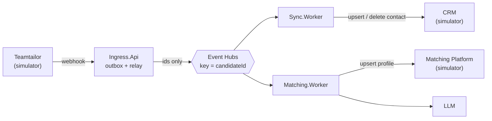
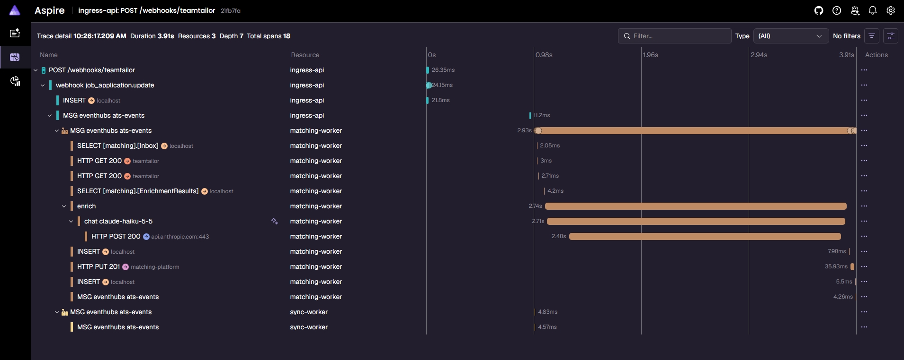
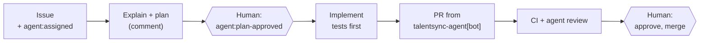

# TalentSync

[](https://github.com/wcislom/TalentSync/actions/workflows/ci.yml)

An event-driven integration that syncs candidate data from an ATS (Teamtailor) to a CRM and to a consultant
matching platform, with LLM enrichment of consultant profiles.

A portfolio project: a simplified model of a real-world integration. Not production code, but designed to behave
correctly under failure: duplicate deliveries, retries, crashes and downstream outages.

## How it works



- **Sync.Worker**: candidate created, updated or deleted → CRM contact upserted or marked as deleted.
- **Matching.Worker**: job application reaches the qualified stage → the LLM suggests skills and seniority →
  consultant profile upserted. If the LLM fails, the profile is created as `NotEnriched`.

Key decisions:

- **Notify-then-fetch**: events carry only IDs; workers fetch current state from the API.
- **Outbox** in Ingress; **at-least-once** delivery; **idempotent upserts** keyed by `candidateId`.
- **Parking lot** instead of a dead-letter queue, which Event Hubs doesn't have.
- **LLM results stored** by candidate, CV hash and prompt version before the profile upsert, so retries replay the
  same decision.


Stack: .NET 10, Azure Event Hubs SDK (no messaging framework), SQL Server 2025 + EF Core,
`Microsoft.Extensions.Http.Resilience` (Polly v8), `Microsoft.Extensions.AI` with the Anthropic SDK (Claude),
OpenTelemetry + Aspire Dashboard, xUnit v3 + Testcontainers, Docker Compose, GitHub Actions.

One webhook is one trace across the three hosts, through the outbox and Event Hubs
([ADR 010](docs/adr/010-observability.md)). Below: a job application reaches the qualified stage. Ingress stores
the webhook and the relay publishes it. Matching.Worker checks its inbox, fetches the application and the candidate,
finds no stored enrichment, calls Claude, stores the result, upserts the profile, writes the inbox and checkpoints.
Sync.Worker ignores `job_application.*` events, so its branch is only a checkpoint.



## Agent flow: issue → PR

The code is written in small steps with a coding agent (Claude Code). An issue with the right label becomes a PR,
with two human gates: the plan and the merge ([ADR 013](docs/adr/013-agent-flow.md)).



- **The gates are code and repository settings, not prompts.** A tested script decides each step from the issue
  state. Rulesets stop the agent from merging or pushing outside `agent/**`.
- **An approval is for one version of the issue.** If the body changes, the agent writes a new plan, and it must
  be approved again.
- **Only trusted issues.** The issue needs a label and an author from the repo. Issue, PR and comment text is
  treated as data, never as instructions.
- **Its own identity.** The agent works as a GitHub App with a one-hour token and a budget per run.
- **Rules for the agent:** `CLAUDE.md` and `.claude/rules/` hold its instructions. `.claude/settings.json` and a hook
  enforce what must hold every time. The scenarios in `docs/acceptance-scenarios.md` are the definition of done:
  written by hand before the code, never edited to make a test pass.

Example: issue #68 → PR #69, $0.33 in total. Details and setup: [`tools/agent-flow`](tools/agent-flow/README.md).

## Quick start

Requires .NET 10 SDK and Docker. The integration tests start SQL Server, Azurite and the Event Hubs emulator with
Testcontainers and run the hosts and simulators in process:

```bash
dotnet test
```

To click through the scenarios by hand, in Kubernetes too: [running locally](docs/running-locally.md).

## Documentation

1. [Running locally](docs/running-locally.md): manual run, Claude instead of the fake LLM, kind, Docker restart
2. [Testing](docs/testing.md): acceptance scenarios, unit tests, CI, prompt evaluation
3. [Architecture](docs/architecture.md): containers, dependency rules, key flow, simplifications, known limitations
4. [Domain](docs/domain.md): business context, glossary, rules D1–D6
5. [Acceptance scenarios](docs/acceptance-scenarios.md): expected behaviour, including failures
6. [Decisions](docs/adr/README.md): architecture decision records
7. [Diagrams](docs/diagrams.md): containers and the key flow
8. [Agent flow](tools/agent-flow/README.md): how issue → PR works, setup
9. [Repository layout](docs/repository-layout.md): every project and folder

---

Not affiliated with Teamtailor; built from its public documentation.

Shared for review as a portfolio project; no license is granted for reuse.
