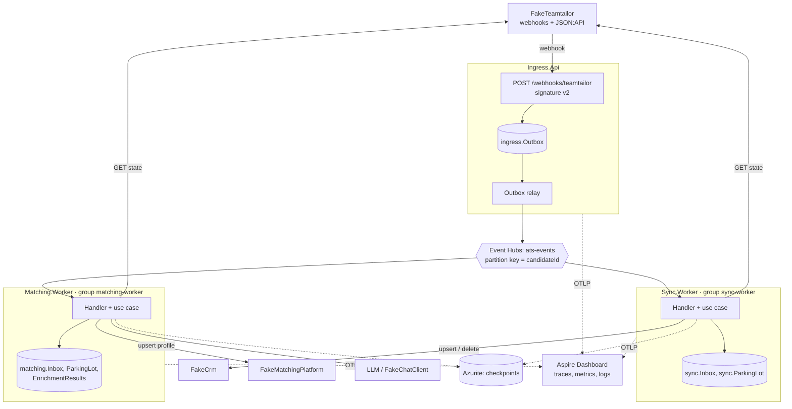
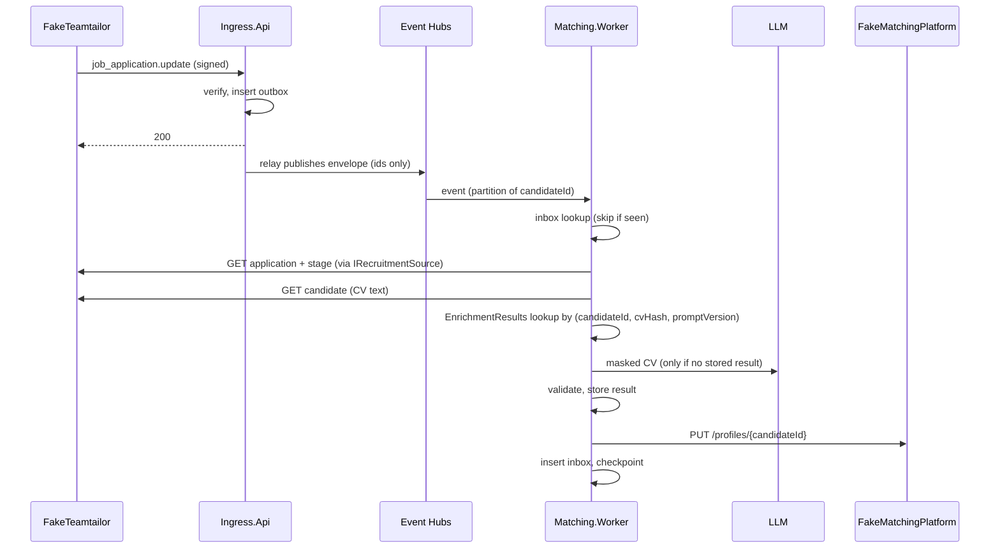
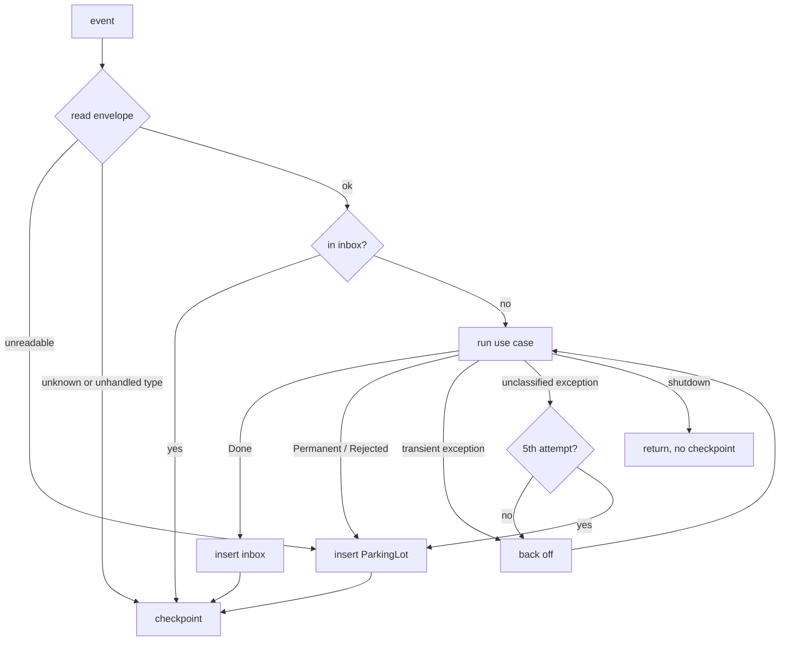

# TalentSync diagrams

For humans. Descriptive: `docs/architecture.md` is the reference for containers, layout and the key flow.
Keep these diagrams true when a container or the flow changes.

## Containers



## Key flow: application qualified



The same flow is one trace in the Aspire Dashboard (ADR 010). Each webhook request is its root; the outbox and
Event Hubs hops are carried by `ingress.Outbox.TraceParent` and the `traceparent` event property. Both consumer
groups appear as branches, Sync.Worker's skipping the event. Span names as the dashboard shows them; the right-hand
column is a comment:

```
POST /webhooks/teamtailor                        ingress-api
└─ webhook job_application.update                ingress-api
   ├─ INSERT                                     ingress.Outbox
   └─ send ats-events                            ingress-api, after the outbox delay
      ├─ process ats-events                      matching-worker, handled
      │  ├─ SELECT [matching].[Inbox]
      │  ├─ GET teamtailor /v1/job-applications
      │  ├─ GET teamtailor /v1/candidates
      │  ├─ SELECT [matching].[EnrichmentResults]
      │  ├─ enrich                               enriched; only if no stored result
      │  │  └─ chat claude-haiku-5-5             model, tokens; "chat" with the Fake provider
      │  ├─ INSERT                               matching.EnrichmentResults
      │  ├─ PUT matching-platform /profiles
      │  ├─ INSERT                               matching.Inbox
      │  └─ checkpoint ats-events
      └─ process ats-events                      sync-worker, skipped_unhandled_type
         └─ checkpoint ats-events
```

An `INSERT` span carries no table name: EF Core prefixes its commands with `SET` statements, and the SqlClient
instrumentation then summarises the command as `INSERT`. The table is in `db.query.text`; values are parameters, never
literals. `checkpoint` is our span around the event processor's checkpoint; the Blob SDK's own requests are not
traced.

## Consumer handler: failure paths


